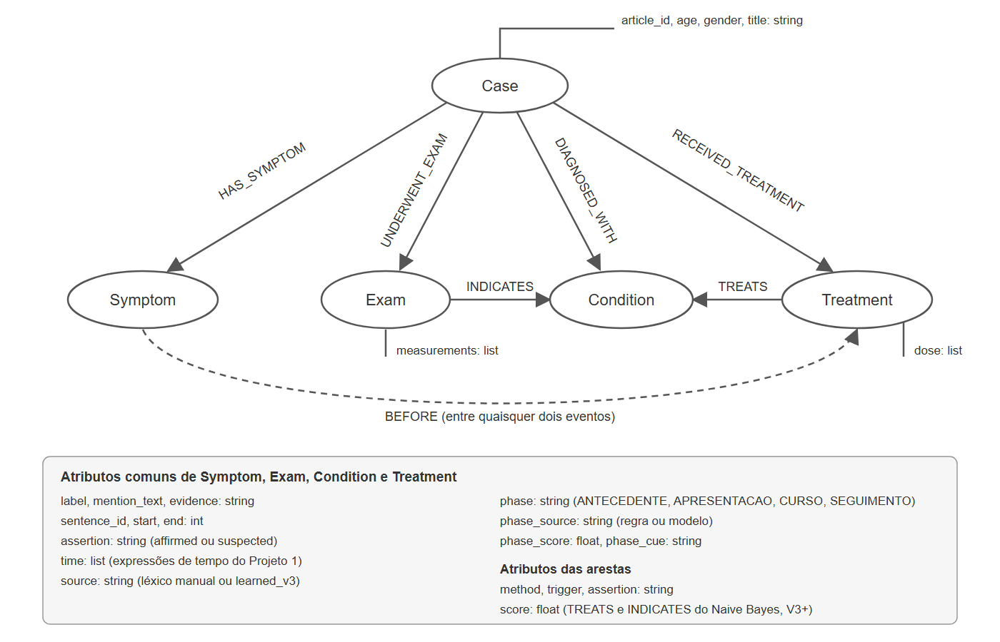

# Projeto O texto clínico pode ensinar o extrator?
# Project Can Clinical Text Teach the Extractor?

Este projeto parte do extrator do Projeto 1, que identifica entidades e relações em relatos de caso clínico a partir de um léxico e de gatilhos escritos à mão. A pergunta é se o próprio texto clínico consegue ensinar ao extrator o que ele não conhecia, usando n-gramas e aprendizado de máquina clássico, sem LLM, Transformers ou embeddings.

## Slides

[Apresentação da parte 2 (PDF)](assets/slides/apresentacao-projeto2.pptx.pdf)

## Demonstração Executável

- [Explorador online](https://lucasboaro.github.io/MC896---NLP/project2/outputs/explorador.html) (GitHub Pages) ou [arquivo local](outputs/explorador.html): V1, V2, V3 e V3+ (mais dados) em uma só página, com seletores de versão, de conjunto (11 casos de avaliação ou todos os 56) e de caso. A aba *Comparar versões* traz os totais por versão e a diferença de entidades e relações entre duas versões no caso escolhido. Os termos aprendidos aparecem com borda tracejada e, no painel de detalhes, com o score do classificador.
- Regerar: `python -m src.visualize_graph --versions-dir outputs/full --eval-cases data/processed/evaluation.csv --scores data/interim/ngram_candidates/candidatos_v3.csv --output outputs/explorador.html`

## Metodologia

O extrator (`src/build_graph.py`) não foi alterado. Só o léxico muda: a V1 foi escrita à mão, a V2 foi ampliada à mão depois de analisar os casos de avaliação, e a V3 é a V1 acrescida de termos aprendidos dos casos de desenvolvimento.

```text
casos de desenvolvimento (45)
   │  n-gramas de 1 a 4 palavras por frase
   ▼
candidatos, filtrados por frequência, stopwords, PMI e NPMI
   │  rótulo fraco: termo da V1 recebe o seu tipo; termo claramente não clínico recebe NONE
   ▼
regressão logística (caracteres do termo, palavras vizinhas e estatísticas)
   │  score = 1 - P(NONE); tipo = classe de maior probabilidade
   ▼
termos novos ranqueados, sem sub-n-gramas, siglas soltas e fragmentos de exame
   ▼
resources/v3/lexicon.csv  →  extrator do Projeto 1  →  grafo V3
```

As etapas são:

1. Candidatos: `src/prototipo_ngramas.py` gera n-gramas por frase, descarta os que começam ou terminam em stopword e exige frequência mínima e colocação (PMI maior ou igual a 3 e NPMI maior ou igual a 0,30 para termos com várias palavras). Como o PMI não existe para uma palavra isolada, unigramas novos só entram com sufixo clínico, como `-itis`, `-oma` ou `-scopy`.
2. Supervisão fraca: termos já presentes no léxico V1 recebem o tipo do léxico (`Symptom`, `Exam`, `Condition` ou `Treatment`). Candidatos com palavras claramente narrativas, como `patient`, `history` e `admitted`, ou com associação fraca recebem `NONE`. Os demais são tratados como desconhecidos: o modelo apenas os pontua e não decide sozinho.
3. Classificador: regressão logística com n-gramas de caracteres do termo (TF-IDF), palavras vizinhas e estatísticas (frequência, PMI, NPMI e número de casos). Os termos conhecidos são pontuados por validação cruzada em 5 partes, e os desconhecidos por um modelo treinado em todos os conhecidos.
4. Limpeza: antes de gerar o léxico, são removidos sub-n-gramas contidos em um termo melhor ranqueado, siglas ligadas ao termo (`acute coronary syndrome acs`) e fragmentos de valores de exame.

Trecho que calcula o score de um candidato:

```python
score = 1.0 - proba[:, none_col]
```

Os 11 casos de avaliação nunca entram na mineração nem no treino do classificador. O repositório contém apenas 56 casos, de 50 artigos, e por isso sobram 45 para mineração e treino.

### Confronto com Trabalho Anterior

| Versão | Como foi construída | Termos no léxico |
|---|---|---:|
| V1 | escrita à mão com os casos de desenvolvimento | 231 |
| V2 | V1 ampliada à mão após analisar os 11 casos de avaliação | 376 |
| V3 | V1 mais termos aprendidos dos 45 casos, sem ver a avaliação | 483 |

Resultado nos 11 casos de avaliação, registrado em `outputs/evaluation/comparison.csv`:

| Resultado | V1 | V2 | V3 |
|---|---:|---:|---:|
| Entidades extraídas | 95 | 247 | 111 |
| Sintomas | 21 | 36 | 22 |
| Exames | 46 | 75 | 52 |
| Condições | 12 | 69 | 20 |
| Tratamentos | 16 | 67 | 17 |
| Arestas | 99 | 266 | 116 |
| Relações entre entidades | 4 | 19 | 5 |

Tomando as entidades da V2 como referência, em nível de entidade e aceitando sobreposição de trechos:

| Sistema | Previstas | Precisão | Revocação | F1 |
|---|---:|---:|---:|---:|
| V1 (léxico) | 95 | 0,99 | 0,38 | 0,55 |
| V3 (léxico) | 111 | 0,85 | 0,38 | 0,53 |

A V2 é uma referência aproximada: foi montada por pessoas depois de ler esses mesmos 11 casos. A V3 tem a mesma revocação da V1 e menos precisão, ou seja, os termos aprendidos acrescentaram entidades, mas quase nenhuma que a V2 reconhece.

## Trabalhos Estudados

- **Colocações por PMI.** Church e Hanks (1990) propõem a informação mútua pontual para medir quanto duas palavras aparecem juntas além do acaso. É a base do filtro de candidatos da V3: um n-grama como `acute coronary syndrome` tem PMI alto, enquanto sequências narrativas não.
- **NPMI.** Bouma (2009) normaliza o PMI para o intervalo de -1 a 1, o que reduz o prêmio que o PMI dá a pares raros. Num corpus de 45 casos quase todo n-grama é raro, por isso usamos os dois e comparamos o AUC de cada um.
- **N-gramas e classificação.** Os capítulos de n-gramas, Naive Bayes e regressão logística de Jurafsky e Martin orientaram a escolha dos classificadores e das características (n-gramas de caracteres e palavras vizinhas).
- **Supervisão fraca.** Ratner et al. (2017), no Snorkel, mostram como funções de rotulagem ruidosas podem treinar um classificador sem anotação manual. Seguimos essa ideia nas três frentes: o léxico V1, os gatilhos e as expressões de tempo do Projeto 1 viram rótulos, e o modelo aprende a generalizá-los.
- **Fase do relato.** No corpus THYME (Styler et al., 2014), cada evento clínico recebe uma relação com o momento da escrita do documento (DocTimeRel: antes, sobreposto, depois). Como os relatos do MultiCaRe raramente têm datas, adaptamos essa ideia para quatro fases do relato: antecedentes, apresentação, investigação e tratamento, e seguimento.
- **Dados.** O MultiCaRe (Nievas Offidani et al., 2025) reúne relatos de caso do PubMed Central. A amostra da disciplina tem 50 artigos e 56 casos; a V3+ usa mais 1000 casos sorteados do conjunto completo.

## Modelo Lógico



O grafo é o mesmo do Projeto 1, com atributos novos que registram o que foi aprendido:

- Nós: `Case` e as entidades `Symptom`, `Exam`, `Condition` e `Treatment`, com o texto da menção, a posição no relato, a frase de origem e atributos como asserção, tempo e dose. O atributo `source` indica se o termo veio do léxico manual ou foi aprendido (`learned_v3`). Os atributos `phase`, `phase_source` (`regra` ou `modelo`), `phase_score` e `phase_cue` guardam a fase do relato.
- Arestas com o caso: `HAS_SYMPTOM`, `UNDERWENT_EXAM`, `DIAGNOSED_WITH` e `RECEIVED_TREATMENT`.
- Arestas entre entidades: `TREATS`, `INDICATES` e `BEFORE`. Na V3+, as arestas `TREATS` e `INDICATES` criadas pelo classificador guardam `method: naive_bayes` e o score.

## Análises que podem ser realizadas

- Quais termos o texto sugere que o léxico manual não tinha, e de que tipo.
- Quanto do trabalho manual da V2 o método reencontra sem ver os casos de avaliação.
- Onde o léxico aprendido erra: palavras genéricas, siglas e fragmentos de valores de exame.
- Quais tratamentos e exames se ligam a cada condição quando as relações vêm do classificador e não só dos gatilhos manuais.
- Em que fase do relato aparecem os sintomas, exames e tratamentos de cada caso, e quais eventos só ganharam fase pelo modelo.

## Ferramentas

O pipeline de aprendizado usa Python 3.12 com `numpy`, `scipy` e `scikit-learn` (ver `requirements.txt`). O sorteio dos casos extras da V3+ lê o `cases.parquet` do MultiCaRe com `pandas` e `pyarrow`. O extrator, a visualização e os testes usam somente a biblioteca padrão. A visualização é uma página HTML com JavaScript, sem dependências externas.

## Resultados

### V3+: mais dados e relações decididas pelo Naive Bayes

A V3+ usa 1000 casos adicionais do MultiCaRe (`data/external/cases_extra.csv`, 1045 casos na mineração), sorteados por `src/sample_multicare.py`: um caso por artigo, só relatos humanos, sem nenhum artigo que já esteja em `cases.csv`. Os 11 casos de avaliação ficam fora da mineração e do treino.

Por que o grafo da V3 tinha tão poucas relações:

1. O Naive Bayes e o PMI de `src/relacoes_pmi.py` só eram avaliados e nunca criavam arestas. `TREATS` e `INDICATES` vinham apenas de gatilhos escritos à mão, que acertam muito e encontram pouco (revocação de 0,31 e 0,57 nos pares rotulados dos 11 casos).
2. Sem condições e tratamentos reconhecidos não há par a ligar. O classificador de tipo errava termos que o sufixo resolve (`tracheostomy` como sintoma, `thrombosis` e `endometriosis` como sintoma, `cardiomyopathy` como tratamento), e unigramas com score baixo, como `appendicitis`, ficavam fora do léxico. Com o léxico da V3, os 11 casos tinham só 7 pares candidatos.
3. A tentativa anterior de aprender gatilhos por autotreinamento falhou: o Naive Bayes, treinado em 49 pares, rotulava quase todo par como positivo (173 positivos para 7 negativos), e o PMI com o rótulo passava a escolher qualquer palavra, como `mass` e `mild`. Ela foi removida.

Correções:

- `prototipo_ngramas.py` com `NGRAM_SUFFIX_TYPES=1`: o tipo de um termo com sufixo clínico vem do sufixo (`-scopy` exame, `-ectomy` tratamento, `-itis` condição), e unigramas com esse sufixo entram no léxico mesmo com score baixo.
- `src/relacoes_classificador.py`: roda o extrator com os gatilhos da V1 e, para cada par tratamento–condição ou exame–condição da mesma frase, cria a aresta quando a regra já a criou ou quando o Naive Bayes dá probabilidade acima do limiar. O modelo é treinado só nos pares rotulados dos casos de desenvolvimento, e o limiar de cada relação sai da validação cruzada nesses pares (0,50 para `INDICATES` e 0,60 para `TREATS`). A aresta guarda `method: naive_bayes` e o score.

```bash
python src/sample_multicare.py CAMINHO/cases.parquet --n 1000
NGRAM_SUFFIX_TYPES=1 NGRAM_EXTRA_CASES=data/external/cases_extra.csv NGRAM_TAG=v3_mais_dados NGRAM_TOP_K=500 python src/prototipo_ngramas.py
python src/relacoes_classificador.py --input data/processed/all_cases.csv --lexicon resources/v3_mais_dados/lexicon.csv --nodes outputs/full/v3_mais_dados/nodes.csv --edges outputs/full/v3_mais_dados/edges.csv
python src/relacoes_classificador.py --input data/processed/evaluation.csv --lexicon resources/v3_mais_dados/lexicon.csv --nodes outputs/evaluation/v3_mais_dados/nodes.csv --edges outputs/evaluation/v3_mais_dados/edges.csv
```

Nos 11 casos de avaliação (`outputs/evaluation/comparison.csv`):

| Resultado | V3 | V3+ |
|---|---:|---:|
| Termos no léxico | 483 | 942 |
| Entidades extraídas | 111 | 143 |
| Condições | 20 | 34 |
| Tratamentos | 17 | 33 |
| `TREATS` | 0 | 2 |
| `INDICATES` | 3 | 9 |
| `TREATS` + `INDICATES` | 3 | 11 |
| Relações entre entidades (com `BEFORE`) | 5 | 13 |

No slide 8, a linha "Relações 3 → 11" corresponde a `TREATS` + `INDICATES`.

Nos 56 casos, `TREATS` vai de 12 para 29 e `INDICATES` de 19 para 49.

Nos pares rotulados à mão dos 11 casos (que o modelo não viu), o Naive Bayes treinado só no desenvolvimento tem, nos limiares escolhidos, F1 de 0,75 em `TREATS` e 0,89 em `INDICATES`, contra 0,44 e 0,73 das regras. Ele ganha em revocação e perde em precisão: com tão poucos pares de treino, aproxima-se de ligar todo par da mesma frase. Das 11 relações `TREATS` e `INDICATES` da V3+ nesses casos, 8 estão corretas numa revisão manual; os erros são `biopsy → kidney injury`, em que a lesão é o motivo da biópsia, e `hydroxychloroquine → cardiomyopathy` e `→ systemic lupus erythematosus`, em frases sobre o nível sérico e sobre a cardiomiopatia causada pelo remédio. O léxico maior também traz ruído, como nomes de fabricantes (`bd biosciences san jose`).

### Termos aprendidos

O método produziu 252 termos novos. Entre os primeiros do ranking há termos clínicos plausíveis que a V2 não tem, como `menorrhagia`, `lymphadenopathy`, `laparotomy`, `angiography`, `craniotomy`, `necrosis` e `laparoscopy`, junto com fragmentos e termos genéricos. A precisão real depende de revisão manual, feita na planilha `outputs/evaluation/revisao_top100.csv`.

### Recall contra o gabarito da V2

Dos 145 termos que a V2 acrescentou, apenas 38 aparecem no texto usado na mineração, e a V3 recupera 1 deles (0,7% do total e 2,6% dos 38). Os números estão em `outputs/evaluation/lexicon_recall.csv`. O corpus pequeno limita o resultado: um termo que nunca aparece no texto não tem como ser aprendido.

### PMI e NPMI

Para separar 39 termos da V1 com várias palavras de 42 n-gramas narrativos, o AUC é 0,55 para o PMI e 0,67 para o NPMI (`outputs/evaluation/association_auc.csv`). A normalização ajuda, mas com poucos exemplos a diferença é frágil.

### Componentes do classificador

Cada variação foi repetida 10 vezes com divisões aleatórias diferentes (`outputs/evaluation/experimentos.csv`; média e desvio padrão):

| Variação | AUC termo da V1 contra NONE | Tipo correto |
|---|---:|---:|
| Base (caracteres, contexto e estatísticas) | 0,935 ± 0,010 | 0,72 |
| Só caracteres | 0,922 ± 0,018 | 0,71 |
| Sem contexto | 0,953 ± 0,008 | 0,64 |
| Sem caracteres | 0,916 ± 0,010 | 0,65 |
| Só estatísticas | 0,914 ± 0,003 | 0,33 |
| Naive Bayes | 0,867 ± 0,014 | 0,70 |
| MLP pequeno | 0,927 ± 0,022 | 0,80 |
| Candidatos de até 2 palavras | 0,927 ± 0,010 | 0,69 |
| Candidatos de até 3 palavras | 0,925 ± 0,010 | 0,71 |

Os n-gramas de caracteres e o contexto são o que ensina o tipo da entidade: só com estatísticas, o tipo correto cai para 0,33. A ordem máxima dos n-gramas quase não importa neste corpus. O AUC é em parte circular, pois os rótulos `NONE` vêm de palavras e do NPMI, que também é uma característica do modelo, e por isso o tipo correto é a métrica mais confiável. A variação com apenas unigramas não pôde ser avaliada, porque os unigramas narrativos já são removidos antes e não sobra nenhum exemplo da classe `NONE`.

### Relações TREATS e INDICATES

O extrator só cria `TREATS` (tratamento → condição) e `INDICATES` (exame → condição) quando encontra um gatilho escrito à mão na frase. O script `src/relacoes_pmi.py` trata cada par tratamento–condição ou exame–condição de uma mesma frase como candidato e decide se a relação existe. Com o léxico V2 nos 56 casos há 97 pares: 43 de `TREATS` e 54 de `INDICATES`. Os 97 foram rotulados à mão (`data/interim/relations/rotulagem.csv`), e 71 são relações verdadeiras. Os métodos comparados são:

- regras: o `build_graph.py` atual;
- regras + gatilhos PMI: as regras mais palavras aprendidas como gatilho, escolhidas pelo PMI entre cada palavra próxima ao par e o rótulo positivo;
- NPMI: limiar sobre o NPMI da coocorrência do par nos casos;
- Naive Bayes e regressão logística: palavras entre as entidades e antes delas; a regressão também usa distância, ordem e NPMI do par;
- sempre sim: referência mínima que responde "existe" para todo par.

Validação cruzada em 5 partes agrupadas por caso (`outputs/evaluation/relacoes_comparacao.csv`):

| Relação | Método | Acurácia | Precisão | Revocação | F1 |
|---|---|---:|---:|---:|---:|
| INDICATES | sempre sim | 0,78 | 0,78 | 1,00 | 0,88 |
| INDICATES | regras | 0,67 | 1,00 | 0,57 | 0,73 |
| INDICATES | regras + gatilhos PMI | 0,72 | 0,94 | 0,69 | 0,80 |
| INDICATES | NPMI | 0,78 | 0,78 | 1,00 | 0,88 |
| INDICATES | Naive Bayes | 0,74 | 0,77 | 0,95 | 0,85 |
| INDICATES | regressão logística | 0,74 | 0,78 | 0,93 | 0,85 |
| TREATS | sempre sim | 0,67 | 0,67 | 1,00 | 0,81 |
| TREATS | regras | 0,70 | 0,94 | 0,59 | 0,72 |
| TREATS | regras + gatilhos PMI | 0,70 | 0,94 | 0,59 | 0,72 |
| TREATS | NPMI | 0,67 | 0,67 | 1,00 | 0,81 |
| TREATS | Naive Bayes | 0,77 | 0,81 | 0,86 | 0,83 |
| TREATS | regressão logística | 0,53 | 0,63 | 0,76 | 0,69 |

As regras são precisas, mas perdem cerca de 40% das relações. Em `TREATS`, o Naive Bayes é o único método que supera as regras e a referência "sempre sim". Em `INDICATES`, nenhum método supera a referência em acurácia, mas os gatilhos aprendidos sobem a revocação das regras de 0,57 para 0,69 mantendo a precisão em 0,94. O limiar de NPMI escolheu o menor valor possível e virou "sempre sim": a coocorrência do par no corpus não separa relações verdadeiras de falsas dentro de uma mesma frase.

Dois cuidados com o PMI aparecem aqui. Primeiro, como 71 dos 97 pares são positivos, o F1 da referência "sempre sim" já é alto, e por isso a acurácia e a comparação com essa referência são necessárias. Segundo, o PMI entre uma palavra e o rótulo positivo tem teto: PMI(t, +) = log2 P(+|t)/P(+) ≤ −log2 P(+), que dá 0,36 com 78% de positivos. Um limiar fixo de PMI não selecionaria nenhum gatilho; o script divide o PMI por esse teto, o que deixa a escala entre 0 e 1, como no NPMI.

Os gatilhos aprendidos ficam em `resources/v3/triggers_aprendidos.csv`. Há termos plausíveis (`consistent`, `suggestive`, `evidence`, `findings`, `presence`) e ruído (`chronic`, `vascular`, `appendix`, e `no`/`but`, que vêm do padrão "showed no X but Y"), por isso a lista precisa de revisão antes de entrar em um `triggers.csv`. Com 97 pares, diferenças de poucos centésimos entre métodos não são confiáveis.

### Linha do tempo: fases aprendidas

Na etapa 1, as regras só posicionavam um evento quando havia uma expressão de tempo explícita perto dele: 15% dos eventos da V3 tinham posição, e havia 12 arestas `BEFORE` nos 56 casos. O script `src/fases_temporais.py` aplica a mesma receita da V3 à linha do tempo. Cada evento recebe uma de quatro fases do relato (antecedentes, apresentação, investigação e tratamento, seguimento), no estilo do DocTimeRel do corpus THYME:

1. Funções de rotulagem com expressões seguras (`history of`, `years ago`, `a 3-day history`, `on admission`, `POD 3`, `follow-up`, `discharged`...) rotulam parte dos eventos. A expressão de tempo explícita vence verbos típicos de fase, e entre expressões sobrepostas vale a mais longa.
2. Essas expressões são mascaradas no texto, para o classificador não decorar as regras.
3. Uma regressão logística usa as palavras ao redor da entidade e da frase anterior, o tipo e o termo da entidade, a posição da frase no relato e a fase das regras nos eventos vizinhos. Como na V3, os casos de avaliação não entram no treino: os de desenvolvimento são pontuados por validação cruzada agrupada por caso, e os de avaliação por um modelo treinado só com os de desenvolvimento.
4. Eventos sem regra recebem a fase prevista quando o score é pelo menos 0,5. Na visualização, aparecem com a marca "fase aprendida" e o score.

| Versão | Eventos | Com tempo (etapa 1) | Fase pela regra | Fase pelo modelo | Com fase |
|---|---|---|---|---|---|
| V1 | 612 | 18% | 44% | 33% | 77% |
| V2 | 828 | 15% | 40% | 36% | 76% |
| V3 | 957 | 15% | 39% | 36% | 75% |

Acurácia contra os rótulos das regras, nos casos de desenvolvimento (V3, 331 eventos):

| Método | Acurácia | F1 macro |
|---|---|---|
| Classe majoritária | 0,489 | 0,164 |
| Copiar a fase do evento vizinho | 0,695 | 0,646 |
| Regressão logística: só posição | 0,468 | 0,417 |
| Regressão logística: só contexto | 0,562 | 0,357 |
| Regressão logística: só vizinhos | 0,640 | 0,618 |
| Regressão logística: sem vizinhos | 0,607 | 0,442 |
| Regressão logística: modelo completo | 0,734 | 0,642 |

O modelo completo é o mais acurado, mas tem F1 macro parecido com o de simplesmente copiar a fase do vizinho, e nas V1 e V2 fica abaixo dele (0,54 e 0,51 contra 0,61), porque tende a puxar eventos para a fase mais comum (investigação e tratamento). A fase dos vizinhos é a característica mais forte: o relato costuma andar em ordem de fases. O NPMI entre as palavras do contexto mascarado e cada fase (`outputs/evaluation/fases/v3/gatilhos_aprendidos.csv`) mostra pistas que não estavam nas regras, como *initially*, *had* e *significant* para antecedentes, *mild*, *intermittent* e *tenderness* para apresentação, e *mg*, *twice*, *daily* e *intravenously* para tratamento.

Essas acurácias medem quanto o modelo reproduz as regras sem ver as expressões delas, e não a acurácia real. Para medi-la, a coluna `gold` de `data/interim/fases/v3/rotulagem_fases.csv` foi preenchida para os 111 eventos dos 11 casos de avaliação, lendo o relato inteiro e sem olhar as colunas das regras e do modelo. A anotação foi feita pelo Claude (assistente de IA usado no projeto), e não por uma pessoa, então é uma referência preliminar que o grupo deve revisar. O critério foi: a fase de apresentação é o atendimento descrito na primeira frase do relato; o que veio antes é antecedente; exames e tratamentos desse atendimento são curso (exames laboratoriais e de imagem iniciais incluídos); o que vem depois da alta ou em readmissões posteriores é seguimento. Três menções que não descrevem um evento do paciente (pneumonia em outros pacientes e uma frase genérica sobre o SLE) ficaram em branco. Uma segunda anotação, também feita pelo Claude mas vendo as colunas das regras e do modelo, concordou com esta em 99 de 107 eventos (kappa de Cohen 0,90). Quase todas as diferenças são exames laboratoriais e ECG da chegada, que a segunda anotação pôs em apresentação. O gold mantido é o da anotação cega.

| Contra a anotação (108 eventos) | Cobertura | Acurácia |
|---|---|---|
| Regras | 38% | 0,805 |
| Modelo, só nos eventos sem regra | 36% (39 eventos) | 0,744 |
| Regras + modelo | 74% | 0,775 |
| Referência: tudo em "investigação e tratamento" | 100% | 0,426 |

No slide 10, a coluna de cobertura mostra os valores dos 957 eventos dos 56 casos (39% pelas regras e 75% com o modelo). Nos 108 eventos anotados, os valores são os desta tabela (38% e 74%). As acurácias são as mesmas.

O modelo praticamente dobra a cobertura e acerta 29 dos 39 eventos que as regras deixavam sem fase, com acurácia um pouco abaixo da das regras. A maior parte dos erros do modelo e das regras confunde apresentação com curso ou seguimento: uma readmissão posterior ("presented", "admitted") parece a apresentação inicial, e exames da chegada ficam entre as duas fases. Com 11 casos e um único anotador, as diferenças de poucos pontos não são confiáveis.

### Conclusão

A parte 1 entregou um extrator interpretável, com léxico, gatilhos e regras de tempo escritos à mão. A parte 2 usou esse extrator como plataforma para medir o que dá para aprender do próprio texto, sem mudar o `build_graph.py`, nas três frentes:

1. **Léxico.** Com 45 casos de mineração, o método aprende a forma dos termos clínicos, mas acrescenta pouca cobertura real: a V3 tem a mesma revocação da V1 (0,38) e perde precisão (0,99 para 0,85). O gargalo está no corpus, e não no classificador. Com 1.045 casos (V3+), o léxico vai de 483 para 942 termos e as condições e tratamentos encontrados nos 11 casos sobem de 20 para 34 e de 17 para 33, com mais ruído.
2. **Relações.** Os gatilhos manuais são precisos, mas perdem cerca de 40% das relações. Um Naive Bayes sobre as palavras entre as entidades recupera relações que eles perdem, com alguma perda de precisão; na V3+ ele passa a criar as arestas `TREATS` e `INDICATES`, e 8 das 11 criadas nos casos de avaliação estão corretas.
3. **Linha do tempo.** A fase aprendida leva os eventos posicionados de 15% para 75% nos 56 casos, com acurácia próxima à das regras contra a anotação (0,775 contra 0,805).

Ficam como continuação: a revisão pelo grupo da anotação de fases e dos gatilhos aprendidos por PMI, que ainda não entram no grafo; um filtro de ruído no léxico (fabricantes e siglas); e o uso da fase prevista para ordenar eventos com arestas `BEFORE`.

## Como Modelos de Linguagem foram Usados

Nenhum modelo de linguagem participa da extração: os candidatos, os classificadores e as fases usam apenas n-gramas, PMI, NPMI, Naive Bayes e regressão logística, como pede o enunciado. Assistentes de IA foram usados como ferramentas de apoio ao grupo:

- **Código e experimentos.** O Claude (Anthropic) ajudou a escrever e revisar os scripts de `src/`, a montar os experimentos de comparação e a conferir os números do README e dos slides contra as saídas.
- **Visualização.** O explorador HTML (`src/visualize_graph.py`) foi construído com assistência de modelos de linguagem, o que o enunciado do Projeto 1 permite para a parte visual.
- **Anotação da fase dos eventos.** A coluna `gold` de `data/interim/fases/v3/rotulagem_fases.csv` (108 eventos dos 11 casos de avaliação) foi preenchida pelo Claude, como descrito em Resultados.
- **Texto.** Rascunhos do plano, do roteiro da apresentação e deste README foram escritos com apoio do Claude e revisados pelo grupo.

Os rótulos das 97 relações (`data/interim/relations/rotulagem.csv`) e a revisão das 11 relações da V3+ foram feitos à mão.

## Referências Bibliográficas

- Bouma, G. (2009). Normalized (pointwise) mutual information in collocation extraction. *Proceedings of the Biennial GSCL Conference*, 31–40.
- Church, K. W.; Hanks, P. (1990). Word association norms, mutual information, and lexicography. *Computational Linguistics*, 16(1), 22–29.
- Jurafsky, D.; Martin, J. H. *Speech and Language Processing* (3ª ed., rascunho). Capítulos sobre n-gramas, Naive Bayes e regressão logística. https://web.stanford.edu/~jurafsky/slp3/
- Nievas Offidani, M.; Roffet, F.; González Galtier, M. C.; Massiris, M.; Delrieux, C. (2025). An Open-Source Clinical Case Dataset for Medical Image Classification and Multimodal AI Applications. *Data*, 10(8), 123. https://doi.org/10.3390/DATA10080123

## Como executar

As instruções de instalação e execução, com a ordem dos scripts e as saídas de cada um, estão em [`src/README.md`](src/README.md). Mais detalhes sobre o extrator herdado do Projeto 1 estão em [Preparação dos dados](../project1/docs/preparacao-dados.md), [Estratégia de extração](../project1/docs/estrategia-extracao.md), [Avaliação do extrator](../project1/docs/avaliacao-extrator.md) e no [README do Projeto 1](../project1/README.md).
